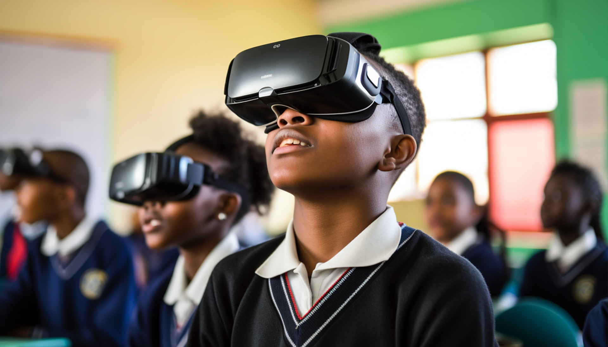

# HezaLab Africa

HezaLab Africa is an immersive STEM education platform built to make practical science learning more accessible to students across Africa. In Rwanda, only 189 of 2,192 secondary schools have science laboratories, according to the Ministry of Education. That shortage limits students' opportunities to explore science through hands-on experiments.

HezaLab brings the laboratory into the classroom through virtual reality (VR), augmented reality (AR), and browser-based 3D simulations. Students can explore experiments in physics, chemistry, biology, and other STEM subjects without relying on costly lab equipment or consumable materials.

The platform is designed to support both students and teachers, with curriculum-aligned experiments, tools for monitoring student progress, and mobile-friendly experiences that do not require a VR headset. We are also exploring offline access to better serve schools with limited internet connectivity. Google's Gemma 4 models are part of our development work, with the goal of supporting learning assistance, experiment explanations, and more personalized experiences.

Our goal is to make practical STEM education more affordable, engaging, and accessible, especially in underserved communities. We hope to help inspire the next generation of African scientists, engineers, healthcare professionals, and technology innovators.

**Every student deserves access to a fully equipped science laboratory, wherever they go to school.**
